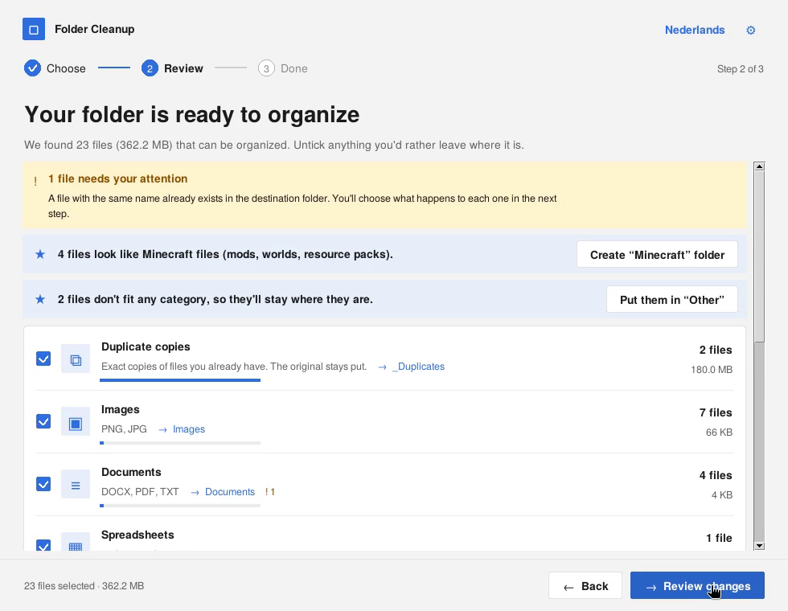
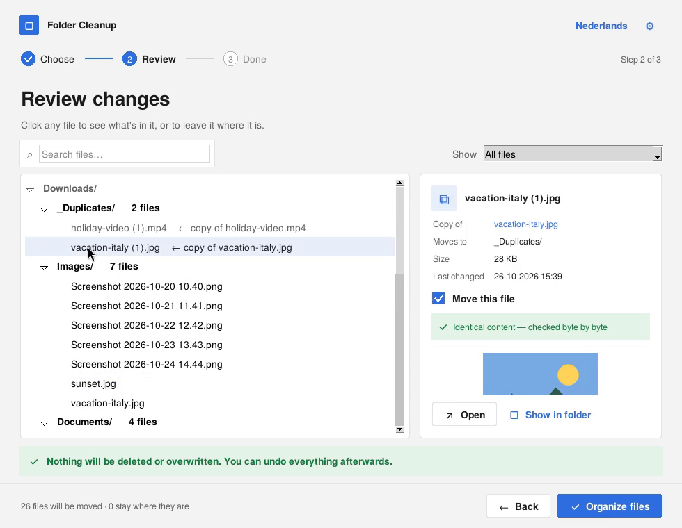
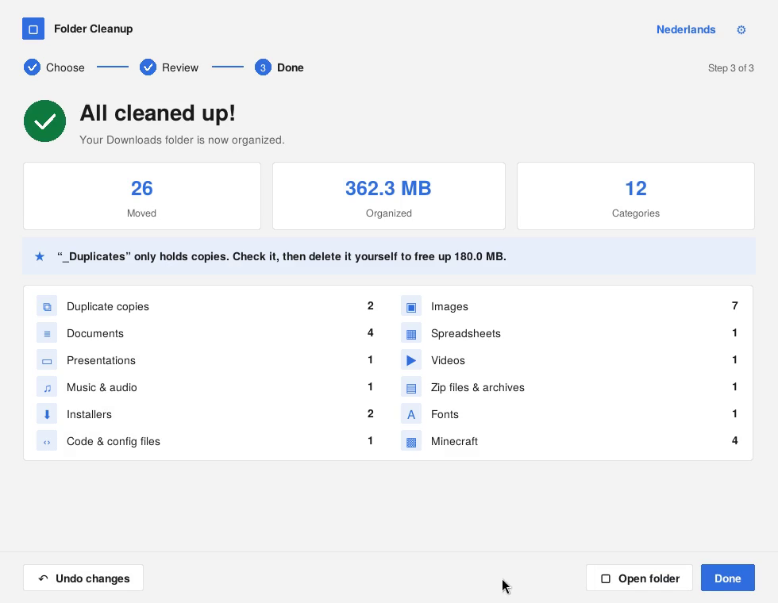

# Folder Cleanup

A small Windows app that tidies up a messy folder (like Downloads) into clear subfolders — **safely**.
You always see exactly what will happen before anything moves, nothing is ever deleted or overwritten,
and every cleanup can be undone with one click.

*Nederlandse uitleg: [zie hieronder](#nederlands).*

*The demo: scan Downloads → accept a smart suggestion → handle a name clash → look inside files → search → organize → undo everything.
([MP4 version](docs/demo.mp4))*

## Features

- **Three simple steps** — Choose a folder → Review the changes → Done.
- **Sorts by type** — Images, Documents, Spreadsheets, Presentations, Videos, Music, Zip files,
  Installers, Fonts, Code, plus an optional **Minecraft** category (mods, worlds, modpacks, resource packs).
- **Finds exact duplicates** — copies (checked byte by byte) go to a `_Duplicates` folder; the original stays put.
- **See what's inside before you decide** — photo previews, the first lines of text and Word documents,
  the contents of zip files, and buttons to open a file or show it in Explorer.
- **Name clashes handled safely** — if a file with the same name already exists, you choose *Keep both*
  or *Skip*. Overwriting is never an option.
- **Real undo** — every cleanup is recorded. Undo the last one, then the one before, and so on.
  Every move is written to a journal immediately, so even after a crash everything can be put back.
- **Your own rules** — e.g. `.psd → Design/`.
- **Leave things alone** — skip files changed in the last 24 hours or larger than a size you choose.
  Folders, hidden files and system files are never touched.
- **Search and filter** the review list, and untick any single file to leave it where it is.
- **Smart suggestions** — e.g. "4 files look like Minecraft files — create a Minecraft folder?"
- **English and Dutch**, Windows 11 look with Fluent icons, Enter/Esc keyboard shortcuts.

| Review | Look inside files | Summary |
|---|---|---|
|  |  |  |

## How to use

1. Install [Python 3.8 or newer](https://www.python.org/downloads/) (tick *“Add Python to PATH”* during setup).
2. Download `folder_cleanup.pyw`.
3. Double-click it. That's all — no other installs needed.

Optional: for previews of JPG/WEBP photos, click **“Turn on photo previews”** inside the app
(or run `pip install pillow` once).

## Safety, in short

| | |
|---|---|
| Deletes files | **Never** |
| Overwrites files | **Never** — a number is added instead, e.g. `invoice (2).pdf` |
| Moves anything before you confirm | **Never** |
| Touches folders, hidden or system files | **Never** |
| Undo | Always available, one cleanup at a time |

The undo history is stored in a hidden file `.cleanup_log.json` inside the folder you cleaned up.
Settings are stored in `.folder_cleanup_settings.json` in your user folder.

---

## Nederlands

**Map Opruimen** zet een rommelige map (zoals Downloads) netjes in submappen — **veilig**.
Je ziet altijd eerst precies wat er gaat gebeuren, er wordt nooit iets verwijderd of overschreven,
en elke opruimactie kun je met één klik terugzetten.

**Zo gebruik je het**

1. Installeer [Python 3.8 of nieuwer](https://www.python.org/downloads/) (vink *“Add Python to PATH”* aan).
2. Download `folder_cleanup.pyw`.
3. Dubbelklik erop. De app opent in het Nederlands als Windows in het Nederlands staat;
   rechtsboven wissel je tussen Nederlands en Engels.

**Wat het doet**

- Bestanden per soort in mappen: afbeeldingen, documenten, video's, muziek, zip-bestanden,
  installatieprogramma's, lettertypen, code en optioneel Minecraft.
- Exacte dubbele bestanden gaan naar `_Duplicates`; het origineel blijft staan.
- Klik op een bestand om te zien wat erin zit voordat je beslist.
- Bestaat de naam al? Jij kiest: *Beide houden* of *Overslaan*.
- Alles terugzetten kan altijd, per opruimactie.
- Eigen regels (bijv. `.psd → Design/`), zoeken, filteren en slimme suggesties.

## License

[MIT](LICENSE)
